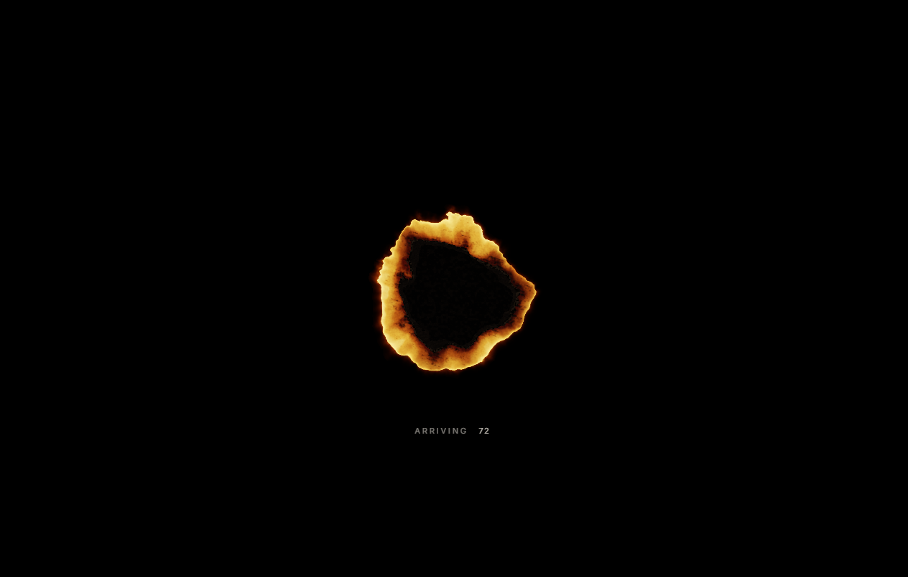
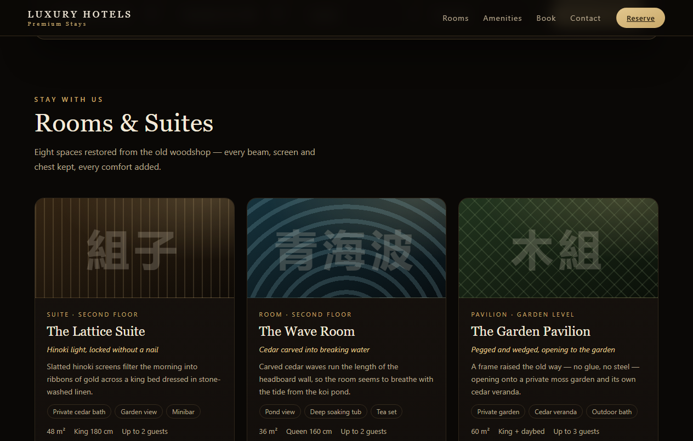
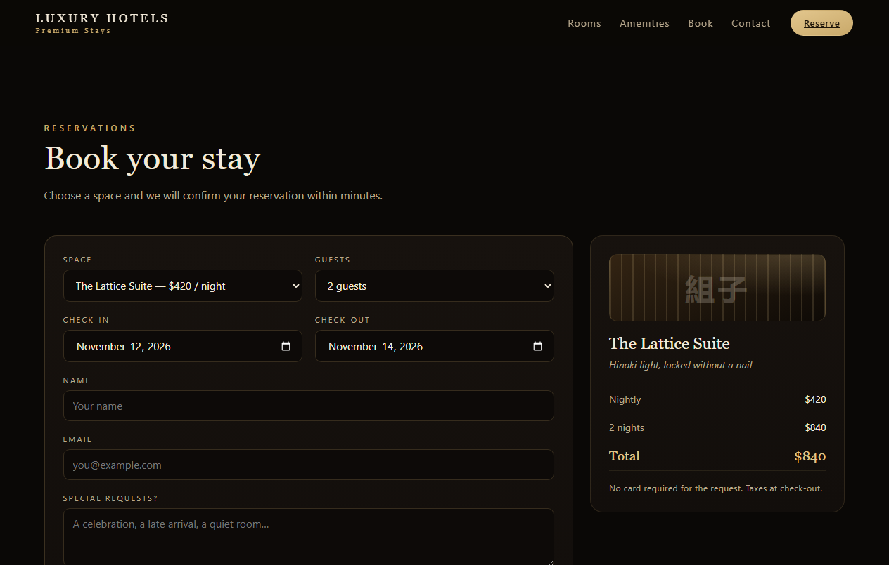

# Luxury Hotels

Premium hotel booking website built with React, Three.js, and the ThreeUI Kibori shader library.

A dark, woodshop-inspired landing experience for an eight-room Kyoto hotel — cedar baths, private gardens, lacquerware table settings, and a workshop still working at the back of the courtyard.

## Live Preview

| Hero / Landing | Rooms & Suites | Book your stay |
|---|---|---|
|  |  |  |

## Features

- **Hero shader landing** — Three.js WebGL burn animation with ship-inspired visuals
- **Rooms & suites** — Eight spaces with kanji-titled cards, guest capacity, and nightly rates
- **Search & booking** — Check-in/check-out dates, guests, room selection, and reservation form
- **Amenities & contact** — Hotel amenities and contact section
- **Responsive** — Dark-mode design that adapts from mobile to desktop

## Tech Stack

- React 18
- Three.js (WebGL)
- ThreeUI Kibori shader landing page
- Vite / Create React App build

## Getting Started

```bash
npm install
npm start       # dev server at http://localhost:3000
npm run build   # production build
```

## Deployment

The production build is deployed to GitHub Pages. See `build/` for the static output.

## License

MIT
