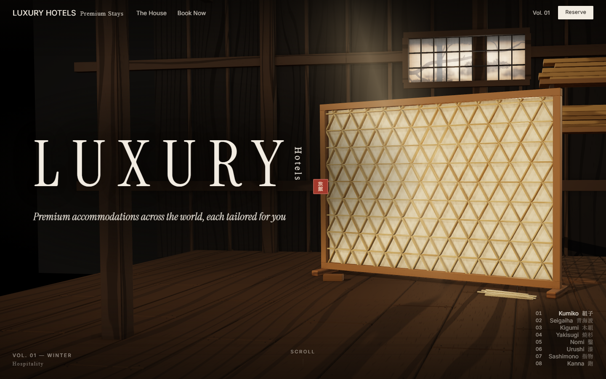
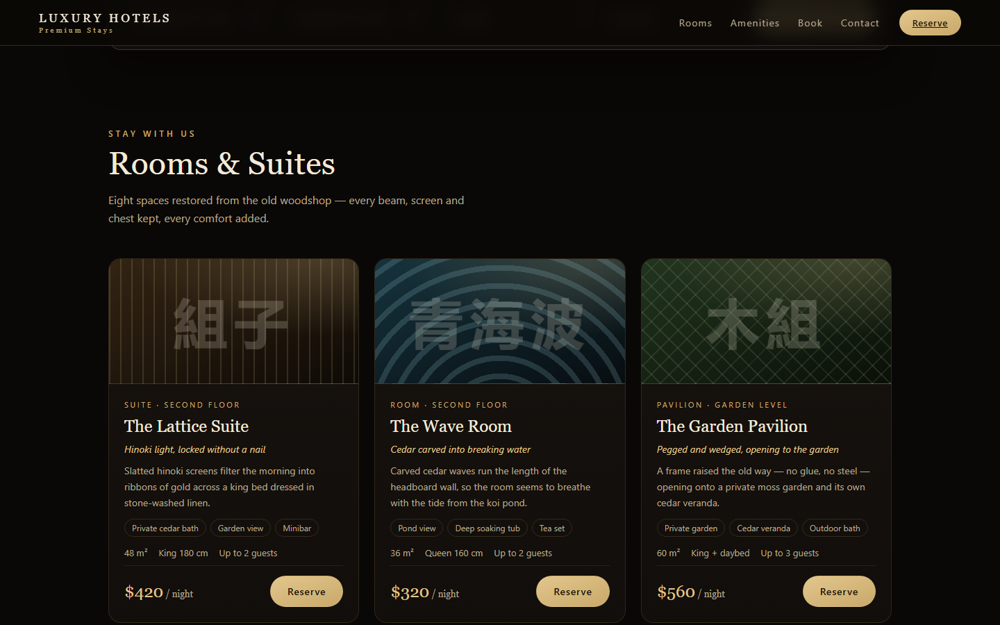
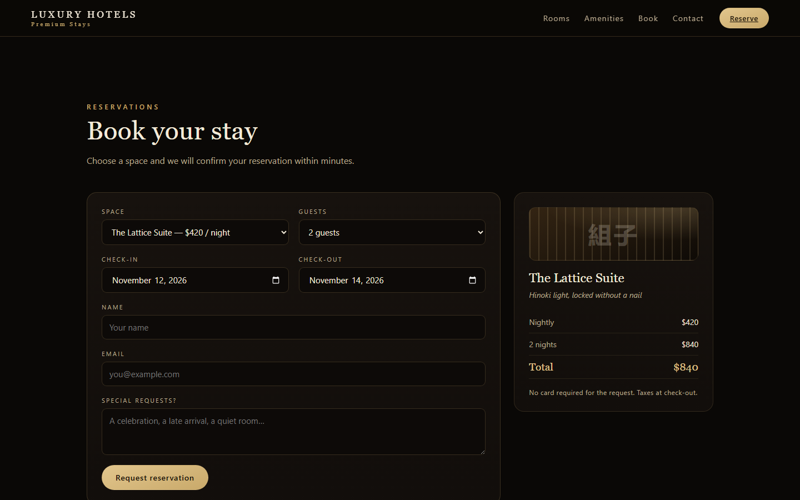

# Luxury Hotels — Premium Stays

A luxury hotel booking website built around the [ThreeUI](https://threeui.com/landing-pages/kibori) **Kibori** interactive landing page (three.js), adapted for hospitality, with a full booking experience in React underneath.







## Features

- **Immersive 3D landing** — the original Kibori scene (three.js + cannon-es physics, scroll-driven camera through eight spaces of a Kyoto woodshop turned hotel). All assets and the three.js runtime are vendored locally — no CDN at runtime.
- **Search** — check-in / check-out dates, guests and room type, with validation and live filtering.
- **Rooms & Suites** — six spaces with craft-motif art, amenities, capacity and nightly rates.
- **Booking flow** — reserve from any room card, live price summary, validation, and confirmation with a reference code.
- **Amenities & contact** — facilities grid, hotel details and an inquiry form with success state.
- **Responsive** dark/gold design with a fixed header that slides in below the hero.

## Tech stack

React 18 · TypeScript · Create React App · three.js r169 (vendored) · plain CSS

## Getting started

```bash
npm install
npm start          # http://localhost:3000
```

Production build and tests:

```bash
npm run build      # output in build/
npm test           # smoke test
```

Serve `build/` from the site root so `/landing-pages/...` resolves.

## Project structure

```
src/
├── components/        # header, search, rooms, amenities, booking, contact, footer
├── data/rooms.ts      # six rooms / suites / residences
├── lib/               # date helpers + booking API stubs (backend seam)
├── shaders/           # KiboriLandingPage component + ThreeUI styles
├── App.tsx            # page composition
└── App.css            # design system
public/
└── landing-pages/     # adapted landing page, 17 verified assets, vendored three.js
```

## Backend integration

Bookings and inquiries are frontend-only today: replace the stub bodies in [`src/lib/bookingApi.ts`](src/lib/bookingApi.ts) with `POST /api/bookings` and `POST /api/inquiries` — component signatures stay the same.

## Documentation

- [`IMPLEMENTATION_REPORT.md`](IMPLEMENTATION_REPORT.md) — integration report and verification log
- `docs-obsidian/` — architecture, component structure, dependencies, features, decisions (Obsidian vault)
- `graphify-out/` — code knowledge graph (`graphify update .` to refresh)

## Credits

Landing experience adapted from the **Kibori** landing page by [ThreeUI](https://threeui.com). The woodshop scene, shaders and interactions are theirs; this project rebrands and wraps them in a hotel booking experience.
